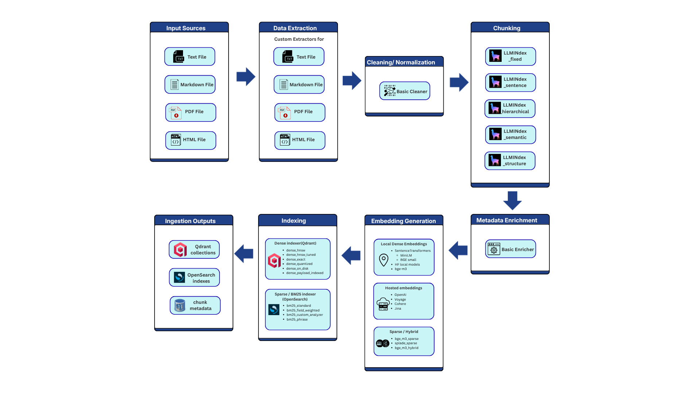
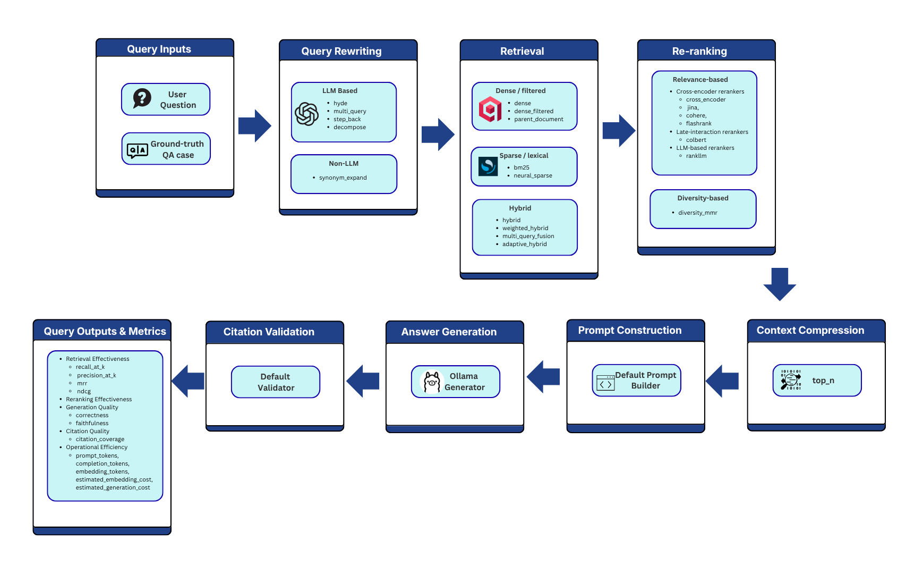

# RAG Benchmark Platform

A React and Python platform for benchmarking advanced RAG pipelines across ingestion and query stages.

This project is intentionally modular. Every stage is implemented behind a small interface and registered through a plugin registry, so new chunkers, extractors, embedders, retrievers, rerankers, compressors, validators, and metrics can be added without rewriting the benchmark runner.

## What v1 supports

### Ingestion pipeline

```text
Raw data
  -> Data extraction
  -> Cleaning / normalization
  -> Chunking
  -> Metadata enrichment
  -> Embedding generation
  -> Indexing into Qdrant / OpenSearch
```

### Query pipeline

```text
User question
  -> Query rewriting / expansion
  -> Retrieval
  -> Filtering
  -> Re-ranking
  -> Context assembly
  -> Prompt construction
  -> Ollama answer generation
  -> Citation / evidence validation
```

### Implemented v1 variants

| Stage | Implemented variants |
|---|---|
| Extraction | TXT, Markdown, PDF, HTML/URL |
| Cleaning | Basic cleaner |
| Chunking | Fixed-size, recursive character chunker, LlamaIndex fixed-size, sentence, hierarchical/parent-child, semantic, and document-structure splitters |
| Embeddings | SentenceTransformers: MiniLM, BGE small, configurable local HF model |
| Indexing | Qdrant dense strategies (`dense_hnsw`, `dense_hnsw_tuned`, `dense_exact`, `dense_quantized`, `dense_on_disk`, `dense_payload_indexed`), OpenSearch BM25 strategies (`bm25_standard`, `bm25_field_weighted`, `bm25_custom_analyzer`, `bm25_phrase`) |
| Retrieval | Dense, metadata-filtered dense, BM25, hybrid reciprocal-rank-fusion, query-adaptive hybrid routing |
| Query rewriting | None, HyDE via Ollama, multi-query paraphrases, step-back conceptual queries, decomposition, local synonym expansion |
| Reranking | None, CrossEncoder reranker, FlashRank, RankLLM, ColBERT, Cohere, Jina, diversity/MMR reranker |
| Context compression | None, top-N trimming |
| Generation | Ollama, default model `gpt-oss:20b` |
| Metrics | recall@k, precision@k, MRR, NDCG, latency, index size, simple citation validation, placeholder answer metrics |

## Architecture

For a detailed walkthrough of the operator journey, service interactions, case
expansion, ingestion/query execution, persistence, artifacts, failure behavior,
and extension points, see [Platform flow](docs/platform-flow.md).

```text
rag-benchmark-platform/
  docker-compose.yml
  .env.example
  configs/
  data/
  services/
    api/        FastAPI service
    worker/     Celery benchmark worker
    ui/         React UI
  packages/
    ragbench_core/
      components/
      engine/
      models/
      registry.py
  scripts/
  tests/
```

The core package keeps its own small interfaces while exposing LlamaIndex chunking as adapter components, rather than making LlamaIndex the foundation of the system.

## Run with Docker Compose

```bash
cp .env.example .env
docker compose up --build
```

The API and worker wait for Postgres to pass its TCP readiness check before
starting. This prevents an API startup `connection refused` error while Postgres
initializes. If Postgres does not become healthy, inspect it with
`docker compose logs postgres`.

Host-accessible services:

| Service | URL |
|---|---|
| React UI | http://localhost:8499 |
| FastAPI docs | http://localhost:7800/docs |

Supporting services such as Postgres, Redis, Qdrant, OpenSearch, MinIO, and Ollama are available only on the Docker Compose network and are not published to the host by default.

MinIO is reserved for future object storage and is excluded from normal startup
by the `minio` Compose profile. The application currently writes artifacts to the
shared `artifacts/` directory. The retained MinIO image may no longer be publicly
pullable; normal startup does not require it.

Ollama is included as a service. Pull the model after containers start:

```bash
docker compose exec ollama ollama pull gpt-oss:20b
```

### Use Ollama on the host

If your machine already runs Ollama locally, set
`OLLAMA_BASE_URL=http://host.docker.internal:11434` in `.env`. The worker includes
an `extra_hosts` mapping to Docker's `host-gateway`, so this hostname also resolves
on Linux Docker Engine. The bundled Ollama service can remain unused.

After changing `.env` or the Compose host mapping, recreate the worker:

```bash
docker compose up -d --no-deps --force-recreate worker
```

A plain `docker compose restart` does not apply these changes. Verify the host
connection from inside the worker before starting a new benchmark:

```bash
docker compose exec worker python -c "import os, requests; r = requests.get(os.environ['OLLAMA_BASE_URL'].rstrip('/') + '/api/tags', timeout=10); r.raise_for_status(); print(r.json())"
```

If the hostname resolves but the connection is refused, ensure the host Ollama
service listens on an address reachable from Docker. On Linux Engine, the default
`127.0.0.1:11434` listener cannot accept connections through the bridge gateway;
configure `OLLAMA_HOST` on the host service and restart Ollama as described in the
[Ollama server configuration guide](https://docs.ollama.com/faq#how-do-i-configure-ollama-server).

Keep `llm.base_url` in your benchmark YAML set to
`${OLLAMA_BASE_URL:http://ollama:11434}` to use the environment setting. If you
instead use the bundled Ollama container, set `OLLAMA_BASE_URL=http://ollama:11434`.
For a benchmark running directly on the host, use `http://localhost:11434`.

## Run a sample benchmark

```bash
cp .env.example .env
docker compose up --build
```

Then use the React UI to upload documents and ground-truth JSON, manage evaluation questions, and configure benchmarks. **Benchmark Setup** includes detailed component forms and a synchronized **YAML source** editor. Load `/app/configs/default.yaml`, select inputs, and choose **Save and run**. **Results Explorer** provides live run statuses, scored answers, traces, retrieval heatmaps, and comparisons.

For frontend development, use Node 22.12 or later: run `npm ci` and `npm run dev` in `services/ui`, then open <http://localhost:5173>. The development server proxies `/api` to port 7800. See [React workspace development and checks](services/ui/README.md) for configuration and testing details.

You can also call the API directly:

```bash
curl -X POST http://localhost:7800/benchmarks/run \
  -H 'Content-Type: application/json' \
  -d '{"config_path":"/app/configs/default.yaml"}'
```

Config files can be listed, loaded, and saved through the API:

```bash
curl http://localhost:7800/configs
curl 'http://localhost:7800/configs/content?config_path=/app/configs/default.yaml'
curl -X PUT http://localhost:7800/configs/content \
  -H 'Content-Type: application/json' \
  -d '{"config_path":"/app/configs/default.yaml","content":"experiment:\n  name: edited_benchmark\n"}'
```

Check job status:

```bash
curl http://localhost:7800/benchmarks/<job_id>
```


## Component configuration parameters

The benchmark YAML is organized around top-level experiment, data, pipeline, LLM, metrics, and runtime sections. Component entries use a `type` key for registry-backed pipeline stages, except embedders and generators, which use `provider`.

### Top-level sections

| Section | Parameter | Required | Default | Restrictions / notes |
|---|---|---:|---|---|
| `experiment` | `name` | No | `benchmark` when persisted; `exp` for case IDs | Run label/case ID prefix. |
| `experiment` | `description` | No | None | Free-form string. |
| `data` | `input_dir` | Yes | None | Local source directory. |
| `data` | `remote_urls_file` | No | None | One HTTP(S) URL per line for `html_url`. |
| `data` | `ground_truth_file` | Yes | None | Ground-truth QA JSON; see format below. |
| `llm` | `provider` | Yes | None | Registered generator; built-in: `ollama`. |
| `llm` | `model` | No | `gpt-oss:20b` in the Ollama generator | Ollama model; supports `${ENV_VAR:default}`. |
| `llm` | `base_url` | No | `http://ollama:11434` | Ollama base URL; env substitution supported. |
| `llm` | `temperature` | No | `0` | Ollama `options.temperature`. |
| `llm` | `timeout` | No | `240` | Seconds; integer-compatible. |
| `metrics` | `retrieval_k` | No | `[3, 5, 10]` for metrics, `[10]` for retrieval limit fallback | Non-empty positive integer list. |
| `metrics` | `enabled` | No | All applicable metrics | Metric allowlist; `[]` disables scoring. |
| `metrics` | `judge` | No | Disabled | Separate Ollama judge configuration; see trustworthy runs below. |
| `runtime` | `mode` | No | `end_to_end` | `retrieval_only` skips answer generation and answer metrics. |
| `runtime` | `max_combinations` | No | `32` | Positive case cap. |
| `runtime` | `collection_prefix` | No | `ragbench` | Index prefix; normalized to lowercase/underscores. |
| `runtime` | `artifact_dir` | No | `/app/artifacts` in default config/settings | Writable artifact path. |

### Ingestion components



| Component | Built-in variants | Parameters | Restrictions / notes |
|---|---|---|---|
| Extractors | `txt`, `markdown`, `pdf`, `html_url` | In YAML, `pipeline.ingestion.extractors` is a list of extractor names, not objects. | File extensions must match extractor; `html_url` requires HTTP(S). |
| Cleaners | `basic` | `type: basic` | No extra params; normalizes whitespace/NULs. |
| Chunkers | `fixed`, `recursive`, `llamaindex_fixed`, `llamaindex_sentence`, `llamaindex_hierarchical`, `llamaindex_semantic`, `llamaindex_structure` | `type`, `chunk_size`, `overlap`; `llamaindex_hierarchical` also accepts `parent_chunk_size`; `llamaindex_semantic` also accepts `breakpoint_percentile_threshold`, `buffer_size`, and `embed_dim` | `chunk_size` default `512`; `overlap` default `0` (fraction/count). Key sizes may be scalars or lists. |
| Metadata enrichers | `basic` | `type: basic` | No extra params; adds length counts. |
| Embeddings | `sentence_transformers`, `openai`, `voyage`, `cohere`, `jina`, `bge_m3`, `bge_m3_sparse`, `splade_sparse`, `bge_m3_hybrid` | `provider`, `model`, `api_key`, `base_url`, `batch_size`, `normalize` / `normalize_embeddings`, `query_prefix`, `document_prefix` / `passage_prefix`, `timeout` | Local providers use SentenceTransformers; hosted providers use their API keys. `batch_size` default `32`; sparse/hybrid providers emit sparse vectors. |
| Indexers | `qdrant`, `opensearch` | `pipeline.ingestion.indexers.dense.type`, `pipeline.ingestion.indexers.dense.strategy`, `pipeline.ingestion.indexers.dense.strategies`, `pipeline.ingestion.indexers.sparse.type`, `pipeline.ingestion.indexers.sparse.strategy`, `pipeline.ingestion.indexers.sparse.strategies`, `pipeline.ingestion.indexers.sparse.synonyms` | Defaults: Qdrant dense and OpenSearch sparse. Use `strategy`/`strategies` to expand cases. |

### Query components



| Component | Built-in variants | Parameters | Restrictions / notes |
|---|---|---|---|
| Query rewriters | `none`, `hyde`, `multi_query`, `step_back`, `decompose`, `synonym_expand` | `type`; `multi_query.count`, `multi_query.temperature`; `step_back.temperature`; `decompose.max_subquestions`, `decompose.temperature`; `synonym_expand.synonyms` | Return `list[str]`; LLM-backed modes fall back to original question. `synonym_expand` is local. |
| Retrievers | `dense`, `dense_filtered`, `parent_document`, `bm25`, `hybrid`, `neural_sparse`, `weighted_hybrid`, `multi_query_fusion`, `adaptive_hybrid` | `type`, `metadata_filters` / `metadata_filter`, `payload_filter`, `doc_id`, `doc_ids`, `base_retriever`, `child_top_k`, `child_top_k_multiplier`, `rrf_k` for `hybrid`, `short_query_mode`, `long_query_mode`, `default_mode`, `short_query_max_terms`, `long_query_min_terms` for `adaptive_hybrid` | Dense needs Qdrant embeddings; BM25 needs OpenSearch. Hybrid uses RRF; adaptive routes by query length. |
| Filters | `none` | `type: none` | No extra params; prefer `dense_filtered` for Qdrant pushdown. |
| Rerankers | `none`, `cross_encoder`, `flashrank`, `rankllm`, `colbert`, `cohere`, `jina`, `diversity_mmr` | `type`, `model` for model-backed rerankers; `api_key`, `top_n`, `timeout`, `url` / `base_url` for Cohere; `trust_remote_code`, `max_length`, `device` for local Jina; `lambda_mult` for `diversity_mmr` | Model/API requirements vary. `diversity_mmr.lambda_mult` default `0.5`; rerankers update scores/ranks. |
| Context compressors | `none`, `top_n` | `type`, `max_chunks` for `top_n` | `max_chunks` default `5`; non-negative integer. |
| Context assemblers | `default` | `type`, `max_context_chars` | `max_context_chars` default `12000`; first assembler only. |
| Prompt builders | `default` | `type: default` | No extra params; first prompt builder only. |
| Citation validators | `simple` | `type: simple` | No extra params; verbatim citation match; first validator only. |
| Generation | `ollama` | Configured in top-level `llm` | Dispatched by `llm.provider`; uses Ollama `/api/generate`. |

### Metrics components

| Metric component | Parameters | Restrictions / notes |
|---|---|---|
| Retrieval metrics | `metrics.retrieval_k` | Non-empty positive integer list; reports raw/reranked retrieval metrics. |
| Operational metrics | `metrics.enabled` | Select `operational` for token/cost data and `latency` for timings. |
| Citation coverage | Ground-truth `expected_citations` | Verbatim expected-citation match. |
| Placeholder answer correctness | Ground-truth `expected_answer` | Lexical placeholder, not semantic. |
| Placeholder faithfulness | Generated answer and assembled context | Lexical heuristic, not LLM-based. |

### Combination expansion behavior

Chunkers, dense indexer strategies, sparse indexer strategies, embeddings, rewriters, retrievers, rerankers, and compressors participate in Cartesian-product case expansion. Chunker, Qdrant dense strategy, and OpenSearch sparse strategy variants are cycled before the later query-grid variants so capped runs still compare configured ingestion strategies early. The default config includes both native chunkers and the LlamaIndex fixed-size, sentence, hierarchical, semantic, and document-structure chunkers; it expands Qdrant across `dense_hnsw`, `dense_hnsw_tuned`, `dense_exact`, `dense_quantized`, `dense_on_disk`, and `dense_payload_indexed`; and it expands OpenSearch across `bm25_standard`, `bm25_field_weighted`, `bm25_custom_analyzer`, and `bm25_phrase`. Cleaner, extractor, metadata enricher, filter, context assembler, prompt builder, citation validator, LLM, metric, and runtime settings are reused across expanded cases. For `context_assemblers`, `prompt_builders`, and `citation_validators`, v1 uses only the first item in each list.

## Ground-truth QA format

```json
[
  {
    "question": "Can an open-box item and downloadable software both be refunded under the current policy?",
    "expected_answer": "Open-box items qualify for the 14-day refund window when all original accessories are returned, but downloadable software is not refundable unless required by law.",
    "ground_truth_doc_ids": ["refund_windows.md", "refund_exclusions.md"],
    "ground_truth_chunk_ids": [],
    "expected_citations": ["refund_windows.md", "refund_exclusions.md"]
  }
]
```

For v1, retrieval metrics can use `ground_truth_doc_ids`; exact `ground_truth_chunk_ids` are optional. `ground_truth_doc_ids` and `expected_citations` may contain multiple documents when an answer requires evidence from more than one source file.

The checked-in sample evaluation set is split across multiple focused policy files under `data/raw/` instead of one large source document. Several questions require evidence from multiple files, while the corpus still includes archived-but-invalid policy wording, exception-heavy answers, table-only facts, negation, abbreviation disambiguation, and retention/warranty edge cases so pipeline variants can be evaluated on multi-document retrieval as well as direct fact lookup.

## Add a new component

Create a class implementing the relevant interface, then register it.

Example chunker:

```python
from ragbench_core.interfaces import BaseChunker
from ragbench_core.models.schema import Document, Chunk

class MyChunker(BaseChunker):
    name = "my_chunker"

    def chunk(self, documents: list[Document], config: dict) -> list[Chunk]:
        ...
```

Register it in `ragbench_core/registry.py`:

```python
REGISTRY.register_chunker(MyChunker())
```

Then use it in YAML:

```yaml
pipeline:
  ingestion:
    chunkers:
      - type: my_chunker
```

## Contributing

Contributions are welcome. See [CONTRIBUTING.md](CONTRIBUTING.md) for development setup, local run instructions, test commands, coding style, and issue/PR expectations.


## License

This project is licensed under the MIT License. See [LICENSE](LICENSE) for the full license text.

## Design notes

This repo deliberately avoids a blind Cartesian product explosion. The runner expands configured variants into benchmark cases, but you should keep early experiments small and controlled. Test retrieval first, then generation. If retrieval fails, answer metrics become noise.

Deferred extensions:

1. RAGAS and DeepEval adapters
2. Additional framework components
3. Synthetic QA generation
4. Distributed worker scaling
5. Team access controls


## Trustworthy runs

Before queueing, the API freezes the resolved configuration, selected local files,
fetched URL bytes, and selected ground-truth questions under
`artifacts/<run_id>/snapshot/`. The manifest records original sources, checksums,
question IDs, and a dataset hash independent of filesystem location. The worker
receives only `run_id`, loads its persisted configuration, verifies snapshot
checksums, and reads the frozen inputs. Direct Python runs create the same snapshot.
Changing a source file, URL, ground truth, or YAML after submission cannot change
the experiment. Duplicate document IDs and question IDs are rejected.

Ground-truth entries may supply `question_id`; legacy entries receive deterministic
IDs from their content. Question edits through the API preserve their existing ID.
Indexes are isolated by run and case. A run ends as `completed`,
`completed_with_errors` (some cases/questions failed), or `failed` (none succeeded
or a top-level error occurred). Queue submission failures are recorded as failed.
Successful question results survive failures elsewhere in the run. Results and
case-level aggregates include valid, missing, and failed counts; missing scores
are never converted to zero. Existing databases gain a nullable question ID column.
Historical runs remain inspectable; rerun them to obtain stable paired identities.
Restart API and workers together when upgrading: old queued task arguments are
incompatible with the new run-ID-only task contract; resubmit those jobs.

To benchmark retrieval without answer generation:

```yaml
runtime:
  mode: retrieval_only
metrics:
  retrieval_k: [3, 5, 10]
  enabled: [recall_at_k, precision_at_k, mrr, ndcg, latency, index_size]
```

LLM-backed rewriters still call Ollama when explicitly selected. Retrieval-only
runs skip context compression, prompt building, answer generation, citation checks,
and the judge. Extractor-specific settings are forwarded to execution.

`metrics.enabled` accepts `retrieval_metrics` (all retrieval scores),
`recall_at_k`, `precision_at_k`, `mrr`, `ndcg`, `operational`, `latency`,
`index_size`, `citation_coverage`, `answer_correctness_placeholder`,
`faithfulness_placeholder`, and the three semantic scores below. Omitting the list
computes all applicable metrics; `[]` disables scoring. Unknown names are rejected.
`index_size` currently reports chunk count, not backend storage bytes.

Enable semantic evaluation separately from the answer model:

```yaml
metrics:
  enabled: [retrieval_metrics, answer_correctness, claim_support, citation_support]
  judge:
    enabled: true
    provider: ollama
    model: "${JUDGE_MODEL:your-local-judge-model}"
    base_url: "${OLLAMA_BASE_URL:http://ollama:11434}"
    timeout: 240
```

The judge saves a versioned rubric, model identity, structured verdicts, reasons,
and evidence quotes. Supported claims/citations must cite matching context text
and document IDs. Correctness is unavailable without a reference answer; empty
claim/citation sets are unavailable. Judge errors yield null scores with saved
error details. Judge usage is stored separately from generation usage. Placeholder
correctness/faithfulness and citation text coverage remain explicitly labeled
heuristics and are excluded from semantic charts.

In Results Explorer, select a baseline run, a candidate run, and one case from each.
The comparison endpoint also accepts `baseline_case_id` and `candidate_case_id`:
`GET /benchmarks/compare?run_ids=<baseline>&run_ids=<candidate>&baseline_case_id=<a>&candidate_case_id=<b>`.
Pairs match stable question IDs only when dataset hashes agree. Output includes
paired means, mean deltas, missing counts, and a deterministic 2,000-resample
paired-bootstrap 95% interval (unavailable with fewer than two pairs). Different
datasets remain available as descriptive results without paired deltas.
