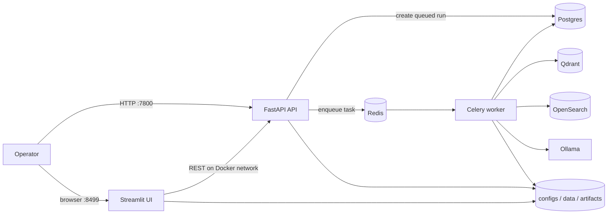
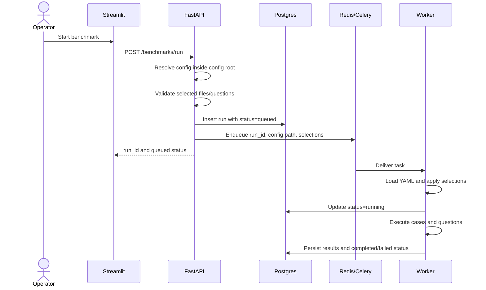
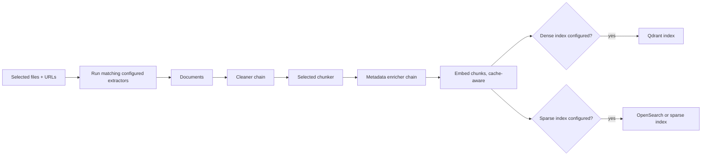

# Platform flow

This document explains how the RAG Benchmark Platform moves from source data and a YAML experiment definition to persisted, comparable benchmark results. It covers the operator workflow, service boundaries, benchmark runner, artifacts, failure behavior, and extension points.

## 1. What the platform does

The platform is an **experiment runner**, rather than a production question-answering API. A run combines:

- a corpus of local files and optional remote URLs;
- a ground-truth list of questions, expected answers, relevant documents/chunks, and expected citations;
- one or more ingestion choices (extractor, chunker, embedder, and index strategy);
- one or more query choices (rewriter, retriever, reranker, compressor, and generation settings); and
- retrieval, quality, latency, token, and cost metrics.

The configuration expander turns those choices into bounded benchmark cases. Each case ingests the selected corpus using one ingestion configuration, answers every selected evaluation question using one query configuration, records a result per question, and contributes to the run aggregate.

## 2. Runtime architecture



| Service | Responsibility | Durable/shared state |
|---|---|---|
| Streamlit UI | Guides data preparation, YAML editing, run launch, status inspection, result exploration, and run comparison. | Calls the API; the shared volumes make the same configuration, data, and artifacts visible in all application containers. |
| FastAPI API | Validates paths and input selections, manages files/questions/configuration, creates run records, enqueues work, and returns runs/results. | Postgres plus the `configs/` and `data/` volumes. |
| Celery worker | Loads the saved YAML and executes `BenchmarkRunner`. The default worker concurrency is one, so queued runs execute serially in that worker. | Postgres, vector/search indexes, embedding/retrieval caches, and `artifacts/`. |
| Redis | Celery broker and result backend; it can also back configured caches. | Redis data for the lifetime of the service. |
| Postgres | System of record for run metadata/status and per-question results. | `benchmark_runs` and `benchmark_results`. |
| Qdrant | Dense vectors, payload-filtered dense retrieval, and optionally neural sparse vectors. | `qdrant_data` volume. |
| OpenSearch | BM25 indexes and optionally neural sparse rank-feature indexes. | `opensearch_data` volume. |
| Ollama | Local answer generation and LLM-backed query rewriting. | Model data in `ollama_data`. |
| MinIO | Provisioned by Compose for future/object-storage use, but the current runner does not write benchmark artifacts to it. | `minio_data` volume. |

With the checked-in Compose file, the UI is exposed at `http://localhost:8499` and API/OpenAPI at `http://localhost:7800/docs`. Supporting services are internal to the Compose network.

## 3. Operator journey

### Step 1: prepare the dataset

In the UI's data area, the operator can upload source documents, upload a complete ground-truth JSON file, preview UTF-8 text files, and create/update/delete individual questions. The API stores source files beneath `/app/data/raw` and the canonical question set at `/app/data/eval/qa.json`.

The ground-truth file is a JSON list. Each entry has this shape:

```json
{
  "question": "What is the refund window?",
  "expected_answer": "The refund window is 14 days.",
  "ground_truth_doc_ids": ["refund_windows.md"],
  "ground_truth_chunk_ids": [],
  "expected_citations": ["refund_windows.md"]
}
```

`ground_truth_doc_ids` supports document-level retrieval scoring, while `ground_truth_chunk_ids` enables exact chunk relevance when known. `expected_answer` and `expected_citations` feed the current answer/citation metrics.

### Step 2: configure the experiment

The operator selects or loads a YAML file in `/app/configs`, edits it, and saves it through the API. Saving parses the YAML first; invalid YAML is rejected rather than written. Environment placeholders such as `${OLLAMA_MODEL:gpt-oss:20b}` are resolved while loading.

The important sections are:

| Section | Purpose |
|---|---|
| `experiment` | Human-readable name and description. |
| `data` | Corpus directory, optional URL list, and ground-truth file. |
| `pipeline.ingestion` | Extractors, cleaners, chunkers, enrichers, embedders, and dense/sparse indexers. |
| `pipeline.query` | Rewriters, retrievers, filters, rerankers, compressors, context assemblers, prompt builders, and citation validators. |
| `llm` | Generator provider, model, endpoint, temperature, and timeout. |
| `metrics` | Retrieval cutoffs and declared metric list. The runner currently invokes every registered metric. |
| `runtime` | Case cap, collection prefix, caches, pricing, artifact directory, and optional exports. |

The UI also lets the operator choose a subset of source paths and question indexes for a run. These selections are run overrides; they do not rewrite the YAML. An empty selection intentionally means no sources or no questions, rather than “all.”

### Step 3: submit the run

The launch request follows this path:



Path resolution confines configuration access to the configured config root and data access to the raw-data root. The generated UUID is the stable run identifier used by the API, database, and artifact directory.

### Step 4: monitor and inspect

The UI reads the run list and selected run from the API. A run normally progresses through `queued` → `running` → `completed`. A top-level runner exception produces `failed`. Individual case failures are isolated and recorded in the completed run summary, so one unsupported or unhealthy component combination does not discard all other cases.

The results area provides:

- run metadata, summary, hashes, models, and exports;
- per-case/per-question answers and metrics;
- retrieval metric tables/heatmaps;
- an evaluation-step view containing rewritten queries, retrieved chunks, context, and prompt;
- saved artifact paths and the expanded case configuration; and
- cross-run comparison, aligned by `(case_id, question)`, with numeric deltas against the first selected run.

## 4. Inside `BenchmarkRunner`

### 4.1 Run initialization and reproducibility metadata

The worker registers built-in plugins, computes a secret-excluding stable configuration hash, captures component/dependency/model identifiers, creates `/app/artifacts/<run_id>`, marks the run `running`, and writes `expanded_config.json`.

It then expands cases, writes `expanded_cases.json`, loads the questions and sources, applies input selection, and hashes the selected dataset contents plus examples. The dataset hash therefore changes when selected file contents, paths, or evaluation examples change.

### 4.2 Case expansion

The expander creates the Cartesian product of configurable ingestion and query variants, including expanded chunk sizes/overlaps and index strategies. It assigns a deterministic case ID derived from ingestion configuration, query configuration, and experiment name, then stops at `runtime.max_combinations` (default `32`).

This distinction is important:

- **run ID** identifies one submitted execution;
- **case ID** identifies a concrete pipeline combination; and
- **result ID** deterministically identifies one `(run, case, question)` result.

Extractors, cleaners, metadata enrichers, filters, and some singleton query stages are reused as configured rather than independently expanded. For context assemblers, prompt builders, and citation validators, the runner uses the first configured item.

### 4.3 Ingestion flow (once per case)



For every selected source, every configured extractor is asked to extract; extractors return no documents for unsupported inputs. The resulting documents pass through the cleaner chain, the case's chunker, and metadata enrichers. The selected embedder populates dense and/or sparse embeddings. The embedding cache avoids recomputing vectors for the same safe embedder configuration and chunk content.

The collection/index name is `<collection_prefix>_<case_id>`, normalized to lowercase with hyphens changed to underscores. Dense and sparse indexers may both persist the same chunks. The runner captures total ingestion, embedding, persistence, client-initialization, token, and chunk-count information for later metrics.

Because ingestion is performed per case, cases with different query settings but identical ingestion settings currently rebuild/reindex the corpus (although embedding cache hits can avoid model inference).

### 4.4 Query flow (once per question per case)


1. The selected rewriter produces one or more queries. LLM-backed rewriters use the configured LLM and fall back to the original query where implemented.
2. Each rewritten query is embedded using the case's ingestion embedder and embedding cache.
3. Retrieval runs for each query up to the largest configured retrieval cutoff. A retrieval cache can reuse results based on retriever configuration, index, query, embedding, and `top_k`.
4. `multi_query_fusion` explicitly fuses result lists. Other modes flatten, score-sort, deduplicate by chunk ID, assign ranks, and truncate.
5. A raw snapshot is retained before filters/reranking. After filtering and reranking, a second snapshot is retained.
6. Compression chooses the chunks that can enter context. The assembler formats and bounds that context; the prompt builder combines it with the original question.
7. The configured generator returns the answer and optional usage metadata. The runner captures rewritten queries, traces, context, prompt, selected chunks, model/token metadata, and stage timings.

### 4.5 Evaluation and aggregation

Every registered metric is invoked for each answer. The built-ins cover retrieval scores (raw and reranked recall/precision/MRR/NDCG at configured `k` values), operational timing/token/cost data, citation coverage, and placeholder answer correctness/faithfulness heuristics. The citation validator also adds validation output.

Metrics are persisted with the answer and case configuration. At the end of the run, each numeric metric is aggregated independently into `mean`, `min`, `max`, and `sum`. Aggregation is over all successful per-question rows; failed cases contribute no metric rows.

## 5. Persistence and artifacts

### Postgres records

`benchmark_runs` contains status, original/overridden configuration, summary, error, dataset/config hashes, version/model metadata, artifact directory, and exports. `benchmark_results` contains one row per successful case/question with metrics, answer, case/evaluation configuration, artifact paths, and model identifiers.

### Artifact tree

The default layout is:

```text
artifacts/<run_id>/
├── expanded_config.json
├── expanded_cases.json
├── cases/<case_id>/
│   ├── case_error.json                         # only when the case fails
│   ├── <result_id>_expanded_config.json
│   ├── <result_id>_retrieval_traces.json
│   ├── <result_id>_prompt.json
│   ├── <result_id>_response.json
│   └── <result_id>_metrics.json
└── exports/
    ├── results.sqlite                          # enabled by default
    └── results.parquet                         # optional
```

Optional runtime export settings can additionally write Parquet or log aggregate metrics/artifacts to MLflow and Weights & Biases. Artifact filenames sanitize path separators and `..` components.

### Caches versus authoritative results

Embedding and retrieval caches are performance optimizations, not the result store. Cache keys omit secrets and include the component/query inputs needed to separate experiments. Postgres and the artifact tree remain the inspectable benchmark outputs.

## 6. Failure behavior and operational caveats

- The API rejects configuration/data path traversal and invalid source/question selections before queueing.
- A bad YAML save is rejected. A configuration that is valid YAML but references a missing plugin generally fails in the worker.
- A case exception is written to `case_error.json`, counted in `summary.errors`, and execution continues with the next case.
- A failure outside case isolation (for example, loading missing ground truth) marks the entire run `failed` and records the error string.
- A completed run may therefore have nonzero errors; inspect both `status` and `summary.errors`.
- A worker crash before the runner handles an exception can leave a run in `queued` or `running`; there is currently no watchdog/reconciliation process.
- Vector/search collections are named by deterministic case ID and are not automatically deleted after a run.
- Run comparison only produces deltas where both runs have the same case ID and question. Because experiment name participates in the case ID, changing it can prevent row alignment even when the pipeline is otherwise identical.
- Metrics listed under `metrics.enabled` are informational in the current implementation; all registered metrics execute.
- “Answer correctness” and “faithfulness” are explicitly placeholder lexical heuristics, not judge-model evaluations.

## 7. API map

| Method and path | Role |
|---|---|
| `GET /health` | Liveness response. |
| `GET /configs` | List YAML files under the configuration root. |
| `GET /configs/content` | Load one permitted YAML file. |
| `PUT /configs/content` | Validate and save YAML. |
| `POST /benchmarks/run` | Validate inputs, create a queued run, and enqueue the worker task. |
| `GET /benchmarks` | List recent runs. |
| `GET /benchmarks/{run_id}` | Fetch run metadata/status/summary. |
| `GET /benchmarks/{run_id}/results` | Fetch per-question results. |
| `GET /benchmarks/compare?run_ids=...` | Return runs, results, and aligned numeric deltas. |
| `POST /data/upload` | Upload source files. |
| `POST /data/ground-truth` | Replace ground truth from a validated JSON upload (maximum 10 MiB). |
| `GET /data/files` | List source files. |
| `GET /data/files/content` | Preview a UTF-8 text file up to 1 MiB. |
| `GET /data/questions` | List evaluation questions. |
| `POST /data/questions` | Append a question. |
| `PUT /data/questions/{index}` | Replace a question. |
| `DELETE /data/questions/{index}` | Delete a question. |

## 8. Extending the platform

Pipeline families are defined by small abstract interfaces and stored in the central component registry. To add a component:

1. implement the appropriate interface and give the class a unique `name`;
2. add an instance to `register_builtin_components()` (or register it before a run);
3. add its YAML schema/parameters to a configuration; and
4. add unit and, where relevant, integration tests.

The runner resolves components by configured name/provider. This keeps orchestration stable while allowing new extraction, chunking, embedding, indexing, rewriting, retrieval, reranking, compression, assembly, generation, validation, or metric behavior.

## 9. Minimal end-to-end example

```bash
cp .env.example .env
docker compose up --build
docker compose exec ollama ollama pull gpt-oss:20b

curl -X POST http://localhost:7800/benchmarks/run \
  -H 'Content-Type: application/json' \
  -d '{"config_path":"/app/configs/default.yaml"}'

curl http://localhost:7800/benchmarks/<run_id>
curl http://localhost:7800/benchmarks/<run_id>/results
```

For quick local, non-Celery execution, `python scripts/run_local.py` loads a configuration and invokes the same `BenchmarkRunner`; infrastructure required by the chosen indexers, generator, and database must still be reachable.
